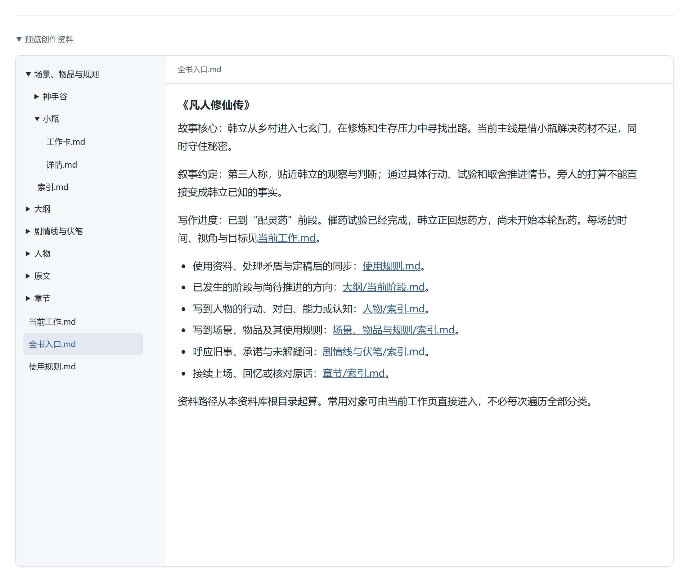
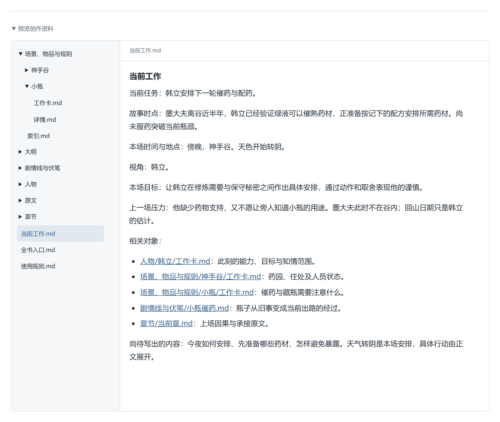
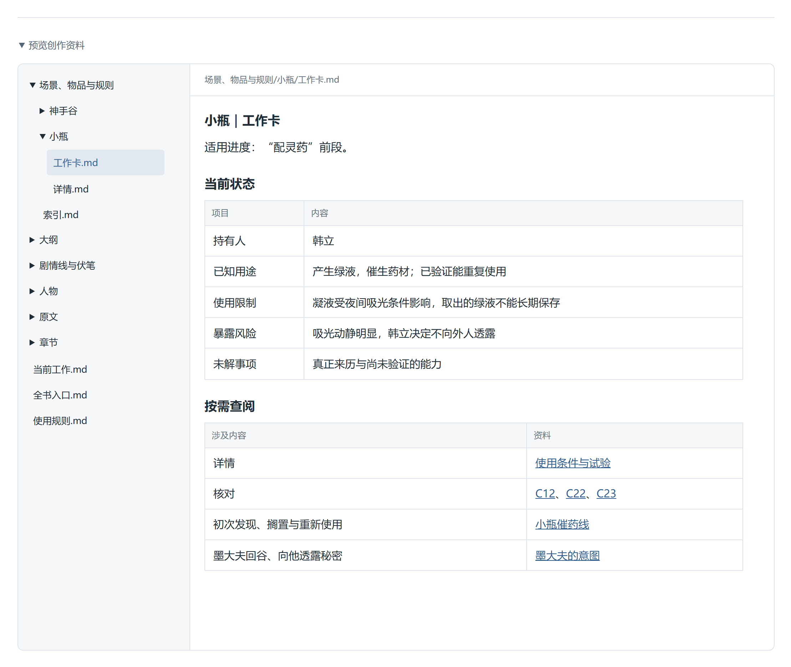
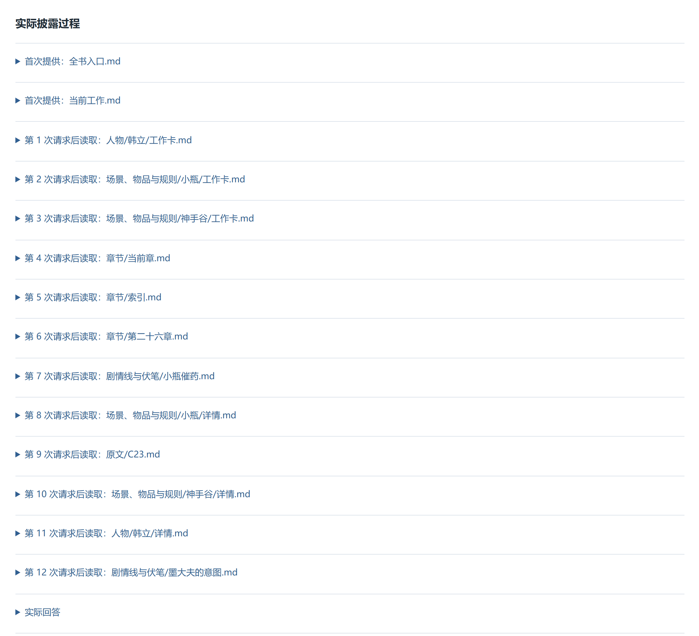
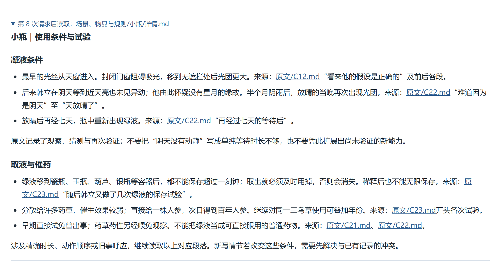
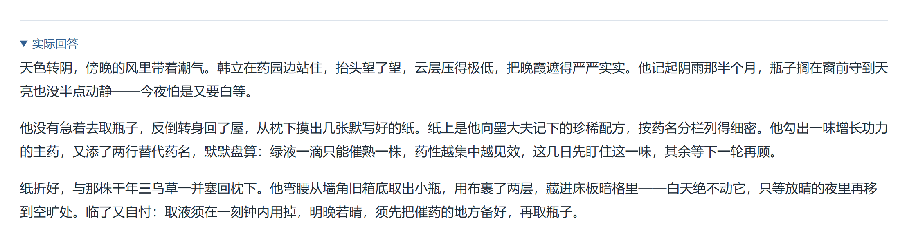
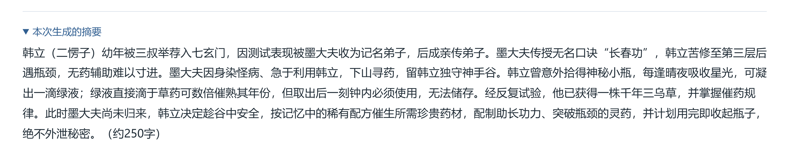
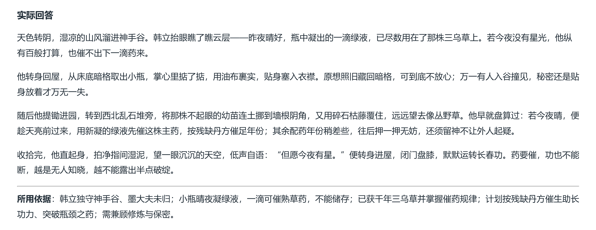
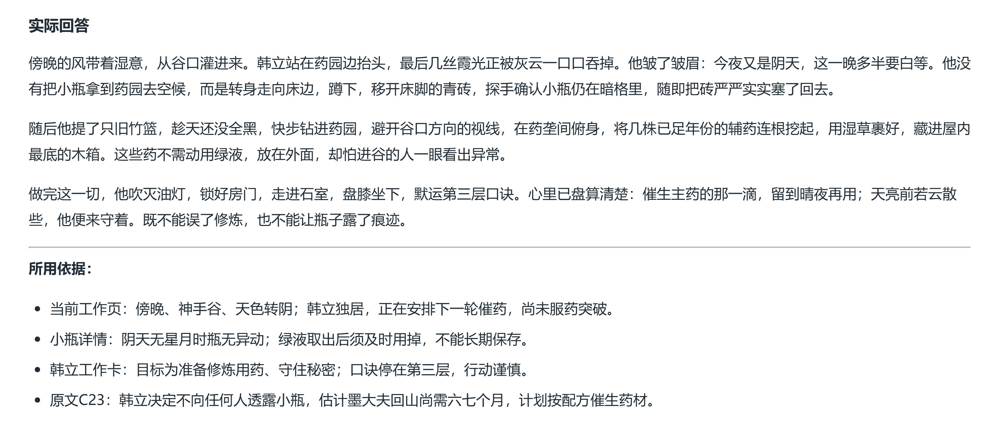

# 渐进式信息披露：设计与实验

## 围绕当前写作任务设计披露层次

现在把自己放到资料设计者的位置。我们已经写过韩立发现小瓶、试验绿液的一段故事，接下来想写：**天色转阴，韩立安排下一轮催药，同时守住秘密。**

先暂时不看现成目录。假如只把这句任务交给 AI，它还缺什么，可能在哪些地方写错？沿着这些缺口，我们可以推导出现在这套资料为什么这样组织。

### 从写作决定，倒推需要的信息

“安排催药”不是一个孤立动作。韩立要不要今夜取瓶、把瓶子放在哪里、先准备什么，都依赖已经成立的设定。

| 本场要作的判断 | 判断依赖什么 |
| --- | --- |
| 今夜能否继续等待凝液 | 小瓶吸光与天气的关系，过去做过什么试验 |
| 怎样藏瓶而不妨碍使用 | 谷内人员、空间遮挡、小瓶吸光时的动静 |
| 怎样盘算墨大夫回谷前的安排 | 他此时不在谷内，回期只是估计；韩立尚未查明他的意图 |
| 这场写完要留下什么变化 | 上一场的压力、本场目标和接下来要承接的安排 |

这样列出来后，我们就知道：只有一段剧情简介不够，但也没有理由先把所有人物经历和全部章节交出去。**资料怎样分层，要看哪些信息会影响当前决定，以及在什么情况下才会用到更多细节。**

### 为什么起步要有两页，而不是一份越来越长的总摘要

先想两个范围不同的问题：换一场戏后，哪些约定仍然成立？哪些信息只属于眼前这一场？

故事主线、叙事视角和资料入口会跨场景使用，所以放在 `全书入口.md`。本实验的入口说明：韩立借小瓶解决药材不足，同时守住秘密；叙述贴近他的观察与判断。这样即使某份档案记着别人的打算，也不能直接写成韩立已经知道的事实。

傍晚、神手谷、天色转阴、修炼与保密的压力，则放在 `当前工作.md`。它还给出韩立、小瓶、神手谷和当前章的入口，把全书资料接到这次续写上。

如果把每章的完整剧情持续追加到这两页，下一场又会带上这些内容，入口就会越来越大。我们只在这两页保留方向、当前任务和选择资料所需的线索；完整人物经历、物品试验与章节原文继续留在各自档案。

可以用一个简单判断检查边界：**下一场换成张铁的旧事，这条信息还需要随任务起步吗？** 仍然约束整部小说的内容留在全书入口；只适用于当前场景的内容放在当前工作；只有涉及某个人物或物品才需要的细节，放进对应档案。

### 小瓶工作卡为什么不能只写“小瓶可以催药”

这句话说明了用途，却没有提示哪些行动还需查条件。如果直接据此写作，阴天取液、换容器储存、把瓶子完全封起来继续吸光等安排，就都缺少条件核对。

看下图的“使用限制”和“暴露风险”两行：

这两行让“天色转阴”“准备囤液”“藏起来使用”变成需要继续核对的情境。查阅表第一项“详情”指向使用条件与试验，第二项“核对”指向相关原文。

为什么不把全部试验都塞进工作卡？因为查持有人、判断是否要保密时，不必同时读完每次试验的过程。但如果把限制也删光，AI 又可能不知道还有条件需要查。**工作卡要足以发现当前决定的约束，详情再解释条件、来由和依据。**

小瓶详情因此保留阴天等候、放晴后出现光团、不同容器保存、分散与集中催药等记录，并指回原文。这里还要区分韩立的观察和猜测，避免把一次试验扩展成从未验证过的能力。

工作卡与详情分别保存，打开一张卡时就不会连同全部经历一起读入。同一文件里多加几个标题，只能方便人浏览，不能让一次全文读取自动减少内容。

对会影响几乎所有场景的硬约束，也可以直接放在全书入口。分层不要求把所有重要信息都藏到下一层；要判断的是它适用多广、何时需要，以及上层是否留下了足够的提醒。

### 为什么还要有人物、场景和剧情线，不能只留章节目录

当我们想到“韩立会不会说出秘密”，手里有的是人物和创作问题，未必有章号。如果只能按章节查，就得先猜这段关系写在什么时候。

所以，资料按写作时容易想到的对象组织：人物承接目标、关系和认知；场景与物品承接空间、资源和使用条件；剧情线承接旧承诺、未解疑问和前后变化；章节则保留事件经过与承接位置。原文仍是精确核对的依据。

韩立工作卡保留“知道绿液可催药，但小瓶来历、墨大夫意图尚未查明”。这条边界能直接约束当前对白。十岁离家、初见绿液却不懂用途等变化，则放在人物详情；写回忆时再按当时的状态使用。

人物详情统一保留稳定设定和按故事阶段排列的变化，工作卡则标明当前适用进度。格式固定，便于查找；同一人物在不同时期的能力和认知仍须分开。

这也解释了分类与层次的区别：**“人物”说明去哪里找，“工作卡、详情、原文”说明这次需要展开多深。** 不能只建几个分类文件夹，再把每个人的全部经历一股脑放进去。

### 怎样检查这套入口真的能引导补读

用本场的一个具体决定来检验：韩立想把小瓶藏进屋里，继续等待凝液。

当前工作页已经指向小瓶和神手谷，因而可以直接进入它们的工作卡。小瓶卡提醒吸光条件与暴露风险，神手谷卡提供人员和空间线索；当我们要判断屋内是否适合吸光时，就有理由展开详情，必要时回查天窗、遮挡与空旷处的原文。

检查时可以先遮住详情，只看上层：**能不能发现这个决定还有条件没确认？能不能知道去哪里补？** 如果只能看到“小瓶可以催药”，就需要补限制与入口；如果上层已经堆满全部试验，则需要把过程移回详情，留下有用的提醒。

再换一个决定：墨大夫回谷后，韩立是否把秘密告诉他？这次应关注人物认知、关系和未解意图，而不是要求它重复上一条天气查证路线。入口可以指引选择，不能把所有任务都规定成同一套读取顺序。

读到足以判断眼前行动、没有影响结论的缺口时，就可以停止展开。若接下来又要写取液保存，再补读保存条件。找不到依据或资料互相冲突时，先保留待确认的问题。

### 写完这一场，怎样让下一场仍找得到变化

假设我们最终采用了“今夜先备药，待放晴再取瓶”的安排，新的待办应进入当前工作和章节交接。如果还确认了新的藏瓶位置，再更新小瓶与地点的相关状态。没有改变的吸光规则无需重写。

人物工作卡保存此刻状态，人物详情保留变化经过；后续写回忆时，可以据此核对当时的认知。尚未采用的方案仍留作计划，不能仅因 AI 写出了一个版本，就当成已经发生的事实。

至此，这套资料的结构就有了来由：全书入口维持方向，当前工作限定本场，相关档案承接创作决定，原文负责精确核对；定稿后的变化又回到下一次能遇见的入口。

实验已经提供文件读取与模型调用能力：在任务与基本约定之外，首次只送入入口和当前工作，详细文件在被实际选中、读回后才进入后续输入。网页上展开预览，不会把内容自动交给模型。这里先掌握资料如何设计；第七章再把这类组织方式接入成熟 Harness。

## 运行现有实验

:::collapse{title="运行渐进式信息披露实验"}
沿用已准备的[课程实验仓库](https://github.com/Ador-able/vibe-coding-course-labs)，打开[渐进式信息披露实验](http://127.0.0.1:4318/requests/disclosure/)。

1. 展开任务说明上方的“预览创作资料”，在左侧目录选择全书入口、当前工作和相关工作卡；正文链接可以继续打开详情与原文。
2. 选择“逐层读取”，点击“运行实验”；也可点击“查看课堂实录”，回看已经保存的真实运行。
3. 展开“实际披露过程”和“运行记录”，核对首次输入、每次返回和下一次输入；再切换全文、摘要条件，比较同一任务的结果。

自行运行沿用顶部的共用模型设置，会产生实际用量；查看实录不调用模型。

:::

图中选择了“逐层读取”，点击“查看课堂实录”即可读回这轮记录；自行运行则点击“运行实验”。

## 读了什么，要用实际返回核对

### 先看首次提供，再看后来读取

选择“逐层读取”，点击“查看课堂实录”，展开“实际披露过程”。图中最上面两项是起步时提供的全书入口和当前工作；后面的条目才是模型在这一轮主动请求读取的文件。

本轮先读韩立、小瓶和神手谷工作卡，第八次请求后读到小瓶详情，第九次后读到 C23 原文，后来又补读人物、地点和剧情线。共发生十二次文件读取，第十三次模型请求返回正文。这是本轮的选择，后续运行应按自己的记录核对，不要求重复同一条路线。

### 展开一项，看看究竟取回了什么

点击“第 8 次请求后读取：场景、物品与规则/小瓶/详情.md”。现在看到的是这次真正读回的全文，不是资料目录中的一句简介。

看“凝液条件”：它保留了阴天等候、放晴后重新出现光团的经过。再看“取液与催药”：保存时长、分散与集中使用的差别各有原文位置。这样才能继续判断“今夜等候是否合适”“换容器能否囤液”，而不只是知道小瓶能催药。

### 再把返回与下一次输入对上

1. 展开“运行记录”中第一次请求的“实际发送的输入”，确认详细档案与原文全文尚未进入；能在资料预览里看见，不等于模型已经收到。
2. 查看第九次请求的实际输入，找到刚才取回的小瓶详情；再看第十次，核对 C23 原文已经进入。它们分别来自前一次真实读取。
3. 对照最终回答，检查它用了哪些条件，有没有把试验结论扩大、把猜测写成事实。读回成功与使用正确，要分别核对。

### 取得依据之后，还要检查有没有用对

我们用同一个标准检查三组：**关键条件有没有保留下来，续写有没有遵守，标出的原文能不能支持这些说法？**

#### 逐层组：读到原文，仍可能把条件理解错

本轮逐层组确实读到了 C23，但最终写出“绿液一滴只能催熟一株”。原文记录的是：分给许多草药，得到大量只有一两年催生效果的普通药材；集中滴在一株上，催生效果更强。这不能推出“只能一株”。**这里的问题是读到了依据，却扩大了原文的结论。**

#### 摘要组：先核对摘要，再核对续写

切换到“只提供本次摘要”，点击“查看课堂实录”，再展开“本次生成的摘要”。这份摘要直接从 30 条小说原文生成，没有使用工作卡或设定档案。

它保留了晴夜凝液、取出后一刻钟内使用、千年三乌草与保密计划，但没有保留遮挡的具体影响、分散与集中催药的试验差别，也没有给出对应的原文编号。因此，不能说摘要把条件全丢了，也不能只凭“掌握催药规律”就认为详细条件都还在。

摘要本身也需要检查。例如，它把墨大夫的意图写成“急于利用韩立”。在当前故事阶段，韩立对墨大夫有所防范，却尚未查明其意图；压缩时不能把这条认知边界丢掉。

再看只凭这份摘要生成的续写：

第三段和“所用依据”都出现了“残缺丹方”。但摘要只说“记忆中的稀有配方”，C23 原文还写到墨大夫会详细告知配方，没有“残缺”这个前提。本轮写作没有补读任何原文，这个说法不能直接当成已有设定沿用。

**这一组要核对两次：原文压成摘要时，有没有改变事实与人物认知；凭摘要续写时，有没有再次增加未经支持的设定。** 只有摘要、没有读取能力的这一组，无法在写作过程中自行回查被省略的原文。

#### 全文组：这轮用上了天气限制，也仍需核对新写的安排

切换到“提供全文”，点击“查看课堂实录”。这组一次收到全部 55 份资料，不需要再通过工具找文件。

这次回答没有安排小瓶在阴夜继续吸光，而是先收存辅药、继续修炼，把催药留到晴夜；人物仍停在第三层。下方还引用 C23，说明韩立决定保密、准备按配方催药。这些内容可以分别与当前工作页、小瓶详情和原文核对。

床脚青砖下的暗格、旧竹篮等，则是本次续写新增加的安排。我们要判断它们是否与已有设定相容，采用后再同步到档案；不能因为全文已经提供，就把回答里的每个细节都当成原有事实。**全文组这轮用上了相关条件，也不代表以后每次都能正确使用全部资料。**

我们要分别检查两件事：必要信息有没有进入上下文，进入后有没有被正确用于当前决定。正文中的新动作、容器或藏物位置可以由创作产生；采用后再同步到档案，不能把每个新增动作都当作资料错误，也不能把尚未采用的安排提前写成事实。

以后运行时，如果工具读取失败或只返回片段，就按实际返回说明缺口，继续取得必要条件。答复结束不等于原文读取成功；错误文字也不能独自证明资料不存在。工具失败、资料缺少、资料尚未读到，需要分开判断。

这次对照只能说明三种读法在本轮的实际表现，还不足以判断哪一种始终更快、更省或更准确。

:::collapse{title="这轮用了多少 token，小说越写越长会怎样？"}
先区分两个数：**一次请求的输入有多大，以及完成整轮实验累计用了多少。** 下面按这三份课堂实录中接口返回的用量相加，包含生成摘要、工具选择和最终回答。

| 组别 | 模型请求次数 | 累计输入 token | 累计输出 token | 合计 |
| --- | ---: | ---: | ---: | ---: |
| 逐层读取 | 13 | 50,484 | 3,153 | 53,637 |
| 提供全文 | 1 | 51,631 | 7,898 | 59,529 |
| 只提供本次摘要 | 2 | 45,825 | 7,919 | 53,744 |

逐层组第一次输入只有 **1,153 token**，最后一次为 **7,191 token**，但累计输入是 **50,484 token**。原因是本实验每次补读后，下一次请求会再次携带已有对话、已读资料和新的返回。最后一次上下文较小，不等于整轮只消耗了这么多。

摘要组先用 **45,395 输入 + 1,071 输出**压缩 30 条小说原文，再用 **430 输入 + 6,848 输出**续写。430 只是写作阶段的输入，不能省略前面的压缩成本。本实验每次运行摘要条件都会重新生成摘要；如果在资料仍有效时复用同一份摘要，才可以让多次写作分摊这次准备成本。

这里的输出包含服务报告的推理 token，并非只有页面上看到的正文。部分逐层请求还命中了输入缓存，缓存 token 已包含在输入统计中；实际费用需要结合所用接口的计费规则，不能把 token 合计直接当成金额。

**如果后面不断加入新章节、人物和档案，仍按这三种方式续写下一场，会怎样？** 下面是由资料提供方式推导出的变化，不是这轮已经做过的长篇规模实测。

| 读法 | 资料越积越多时 | 需要留意什么 |
| --- | --- | --- |
| 提供全文 | 每次续写都带上扩大的资料库，单次输入随资料量增长 | 无关旧事也占用上下文；超过模型的输入容量后，无法继续照搬全部提供的方式 |
| 只提供摘要 | 若摘要保持简短，写作阶段的输入可以保持较小；但本实验重新生成摘要时仍需读取全部小说原文 | 固定篇幅要容纳更多内容，哪些信息被压掉、出处是否清楚都要核对；持续加长摘要，又会使写作输入变大 |
| 逐层读取 | 若入口保持简明，新增的无关章节不必随每场戏进入上下文 | 入口与工作卡要更新；跨越更多人物、旧事时会读得更多，多次往返也会增加累计用量 |

例如，后面新增十章其他人物的经历，我们仍只写韩立安排催药：全文组会带上这些新章节；摘要组要重新压缩，或核对旧摘要是否仍有效；逐层组可以不展开无关章节。若改写一场汇合多条旧线索的戏，逐层组也应补读更多依据。

所以，长篇写作需要控制入口的长度、维护当前状态，并让旧事能被重新找到。**渐进式信息披露让本场需要的资料进入上下文；它不保证每轮固定用量，也不保证一定比其他方法便宜。**

:::

:::exercise{title="这场戏还需要读到哪里？"}
:::question
当前工作页写着天色转阴，韩立要兼顾催药与保密。模型已经读过韩立和小瓶的工作卡，准备考虑两个方向：

- 把小瓶移进屋内，避开旁人，继续等待吸光。
- 先收起小瓶，今夜整理药方，等天气合适再催药。

要判断这些安排是否成立，还缺哪些依据？你会沿哪些入口补读，读到什么程度可以停下？确认采用一段正文后，哪些档案应更新，哪些不必改动？

:::

:::answer
需要核对天气与空间遮挡怎样影响吸光。可以从小瓶工作卡进入详情，按其中指向回查阴天等候、放晴后凝液，以及屋内天窗、移到空旷处的原文。只把瓶子移进屋里，不能自动解决阴天与遮挡问题。

读到足以判断本场行动即可，不必把所有人物和所有章节都读一遍。若接下来还要写分装、囤液或具体催药数量，再展开保存与用量相关的记录。

定稿后更新本场章节卡、当前工作和相关计划；如果物品位置或人物认知也发生变化，再同步对应工作卡。没有改变的世界规则无需重写，也不能把“今夜暂缓”记成“小瓶从此不能使用”。

:::
:::
